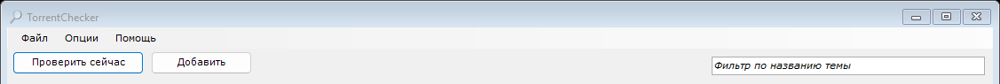

# TorrentChecker
Автоматический поиск и скачивание торрентов по выбранным ключевым словам и опциям

[История изменений](CHANGELOG.md)



Не хотите пропустить нужную раздачу? Поручите это TorrentChecker! Небольшая и простая в использовании программа позволит вам настроить нужный список ключевых слов и будет периодически опрашивать трекеры на предмет наличия подходящих тем.

Как установить программу?
---
Скачайте архив `TorrentChecker-<версия>-windows.zip` из [последнего релиза](https://github.com/TheTitanrain/TorrentChecker/releases/latest). Распакуйте его в отдельную папку и запустите `TorrentChecker.exe`. Оставьте `TorrentChecker.exe.config` рядом с EXE.

Как сменить язык интерфейса?
---
Откройте «Опции» → «Настройки программы». В списке «Язык интерфейса» выберите Русский, English, Українська, Қазақша или Беларуская и нажмите «Сохранить». Интерфейс переключится сразу.

Пункт «Язык системы» использует язык интерфейса Windows. Он выбран по умолчанию, если язык ещё не настроен. Для неподдерживаемого языка Windows программа использует русский.

Как работать с программой?
---
RuTracker работает через публичные Atom-ленты и не требует логина и пароля. Для Кинозала необходимо ввести логин/пароль в "Опции" -> "Настройки подключения".
Автопроверку при старте можно включить без учётных данных RuTracker: публичные Atom-ленты доступны без авторизации. Требуется хотя бы одно правило (ключевое слово). Настройки с Кинозалом или обоими трекерами также можно сохранить с включённой автопроверкой; при проверке Кинозала по-прежнему выполняется обычная авторизация.
В верхней части главного окна нажмите «Добавить» справа от «Проверить сейчас». Введите метку для списка слева и ключевое слово или фразу для поиска. Так же поддерживается режим поиска всех тем, для этого поле "Ключевое слово или фраза" нужно оставить незаполненным.

После настройки ключевых слов нажмите «Проверить сейчас». Найденные торренты появятся в правой части главного окна. Следующие проверки запускаются автоматически с заданным интервалом.

Повторное нажатие «Проверить сейчас» запускает новый цикл проверки и отменяет предыдущий, если он ещё идёт. Поздние ответы и ошибки отменённого цикла не меняют результаты, журнал, индикаторы, время последней проверки и таймер нового цикла, не сохраняют настройки и не отправляют раздачи в клиент. При выходе незавершённая проверка также теряет право обновлять окно. Пауза позволяет закончить текущее правило, затем останавливает проверку; возобновление запускает новый цикл.

RuTracker: разделы Atom и magnet-ссылки
---
1. Откройте нужный раздел RuTracker в браузере. Если вы на странице отдельной раздачи (`viewtopic.php?t=…`), нажмите на название раздела над темой, чтобы перейти к списку тем.
2. Скопируйте число после `f=` в адресе раздела. Например, в `https://rutracker.org/forum/viewforum.php?f=486` ID раздела «Зимние виды спорта» — `486`.
3. В правиле отметьте RuTracker, нажмите «Разделы Atom» и введите ID. Для нескольких разделов перечислите номера через запятую, например `486,123`. Нажмите «Сохранить», затем «Проверить сейчас» в главном окне.

По умолчанию используется раздел `486` («Зимние виды спорта»). Старый выбор «все форумы» также преобразуется в `486`.

Поиск выполняется по недавним записям выбранных лент, а не по всему архиву трекера. Ключевая фраза ищется в названии без учёта регистра; пустая фраза выбирает все записи. Дополнительный Regex-фильтр, фильтры размера и ID темы применяются к найденным результатам. Например, для раздела `486` можно задать фразу «Горные лыжи» и Regex-фильтр «Кубок мира».

Если дополнительный Regex-фильтр содержит синтаксическую ошибку или превышает лимит времени сопоставления (1 секунда), программа записывает ошибку в журнал и отклоняет весь новый набор результатов текущего правила, включая уже прошедшие фильтр строки. Прежние результаты сохраняются; новые записи не попадают в историю и не отправляются в клиент. Индикатор проверки снимается, и обработка продолжается со следующего правила.

Чтобы открыть раздачу вручную, выберите одну строку с magnet-ссылкой и пункт «Открыть magnet в торрент-клиенте» в контекстном меню. Windows откроет её в приложении, связанном с протоколом `MAGNET`.

Одинаковые разделы загружаются один раз за цикл проверки. Обновления раздач определяются по info hash; записи без magnet-ссылки отображаются, но не отправляются в клиент.

### Автоматическая отправка в торрент-клиент

В разделе «Поведение» правила включите отправку в торрент-клиент. Пустая командная строка использует ассоциацию Windows для `MAGNET` у RuTracker и для `.torrent` у Кинозала. Чтобы задать параметры запуска или выбрать другой клиент, заполните то же поле.

| Плейсхолдер | Значение |
| --- | --- |
| `%ClientPath%` | Путь к программе, назначенной в Windows по умолчанию для `MAGNET` или `.torrent`, в зависимости от источника. Можно вместо плейсхолдера указать путь к `.exe` в кавычках. |
| `%TorrentSource%` | Magnet-ссылка RuTracker или путь к временному файлу `.torrent` Кинозала. |
| `%TorrentName%` | Заголовок Atom или имя из `.torrent` с заменой недопустимых для пути символов. |

Ссылки «Сброс» доступны, когда включена автоотправка и выбран хотя бы один трекер. Они заполняют поле команды, которое можно отредактировать перед сохранением правила.

После подтверждения ссылки µTorrent Classic и qBittorrent подставляют шаблоны с `%ClientPath%`. Назначьте соответствующий клиент программой по умолчанию для нужного источника в Windows или укажите путь к его EXE в шаблоне. Ссылка qBittorrent подставляет команду, которая скрывает диалог при автоотправке. Глобальную настройку показа диалога можно оставить включённой для ручного добавления. [Параметры qBittorrent](https://github.com/qbittorrent/qBittorrent/blob/release-5.2.4/src/app/cmdoptions.cpp#L1852)

```text
%ClientPath% --save-path="C:\PathToSave" --skip-dialog=true %TorrentSource%
```

В обоих шаблонах замените `C:\PathToSave` на свою папку загрузок. Сброс для µTorrent Classic подставляет команду с подпапкой по имени раздачи. В правиле Кинозала параметр `/directory` позволяет добавить локальный `.torrent` без диалога. [Параметры µTorrent Classic](https://documentation.help/uTorrent/AppendixB_04.html)

```text
%ClientPath% /directory "C:\PathToSave\%TorrentName%" %TorrentSource%
```

Для других клиентов можно использовать команду `%ClientPath% %TorrentSource%`, если нужный клиент назначен в Windows программой по умолчанию для соответствующего источника.

В смешанном правиле оба источника используют одну команду. Проверьте, что её параметры подходят обоим источникам и клиентам, если в Windows назначены разные ассоциации. При загрузке старых настроек `%TorrentPath%` заменяется на `%TorrentSource%`, и в смешанных правилах прежняя команда Кинозала сразу применяется также к magnet-ссылкам RuTracker. Это касается и `/DIRECTORY`, для которого приём magnet в µTorrent Classic не подтверждён. Для старых правил только с RuTracker поле начинается пустым.

Скачанный `.torrent`-файл передаётся на сохранение и в клиент только при `Content-Type: application/x-bittorrent`. Если заголовок отсутствует или содержит другой тип, программа записывает причину отказа в журнал и не сохраняет файл и не запускает клиент.

Имя `.torrent` извлекается из словаря `info`: непустое поле `name.utf-8` имеет приоритет над `name` независимо от порядка полей. Длины bencode считаются в байтах, поэтому кириллица и emoji не обрезаются; бинарное поле `pieces` и вложенные посторонние имена не влияют на результат. Имя декодируется как UTF-8 с заменой ошибочных последовательностей символом `�` (автоопределения старых кодировок нет), недопустимые символы имени файла заменяются на `_`. До возврата имени проверяется структура всего bencode. Повреждённая структура, неверные типы целевых полей, повторные `info`, `name` или `name.utf-8` на соответствующем уровне, лишние байты после корневого словаря и вложенность более 64 контейнеров дают пустое имя. Это разбор имени, а не полная проверка метаданных торрента: прочие поля не обязательны, сортировка ключей не требуется.

### Если в Windows 11 нужного клиента нет в списке для `MAGNET`

Скрипт [Register-MagnetClients.ps1](Register-MagnetClients.ps1) добавляет **qBittorrent** и **µTorrent Classic** в список обработчиков `MAGNET` для текущего пользователя. Он поддерживает установленные и переносные копии и запускается без прав администратора.

1. Если у вас переносная версия, сначала запустите торрент-клиент, чтобы скрипт нашёл его EXE.
2. Скачайте скрипт по ссылке выше, откройте PowerShell в папке с ним и выполните команду.

   ```powershell
   powershell.exe -NoProfile -ExecutionPolicy Bypass -File .\Register-MagnetClients.ps1
   ```

3. Нажмите **Enter**, чтобы принять найденный путь, или укажите полный путь к EXE вручную. Чтобы пропустить программу, введите `-`.
4. В открывшихся параметрах Windows найдите `MAGNET`, выберите **qBittorrent (MAGNET)** или **µTorrent Classic (MAGNET)** и нажмите **«Задать по умолчанию»**.

Настройки, история и перенос со старой версии
---
Рядом с EXE хранятся `settings.json` (читаемый UTF-8 с настройками и правилами поиска) и `history-<id>.json` (найденные раздачи и история для проверки повторов). Для резервной копии или переноса закройте программу и скопируйте `settings.json` вместе с файлом истории, указанным полем `historyId`. Редактируйте настройки при закрытой программе и сохраняйте служебные поля `version`, `historyId` и `credentialId`.

В окне общих настроек срок хранения истории задаётся целым числом дней не меньше 1. При ошибке выделяется поле срока хранения. Если в `settings.json` или импортируемом `settings.dat` сохранён нулевой либо отрицательный срок, при загрузке используется 30 дней (2592000 секунд); следующее сохранение записывает исправленное значение. Положительные сохранённые значения в секундах сохраняются точно, без округления до дней. Исходный файл старых настроек при восстановлении не изменяется.

Логины и пароли трекеров и прокси хранятся в Диспетчере учётных данных Windows. Используйте отдельную папку с правом записи для каждого пользователя Windows. После смены папки, компьютера или пользователя введите учётные данные заново в окне «Авторизация». Для прокси логин и пароль необязательны. Если меняете адрес или порт прокси, введите новые учётные данные там же, когда они нужны для подключения.

Для обновления закройте старую версию, сделайте резервную копию `settings.dat` и поместите файл рядом с новым EXE. Если `settings.json` ещё отсутствует, при запуске программа предложит импорт. Подтверждайте только импорт файла из доверенной копии TorrentChecker. При отказе программа завершится. После успешного переноса проверьте правила, историю и вход на трекеры. Исходный `settings.dat` остаётся без изменений и содержит пароли без шифрования, поэтому храните его копии в защищённом месте или удалите после проверки.

Если вы одновременно переходите с HTML-поиска на Atom, выполните первую проверку без автоматической отправки в клиент. Из-за смены идентификатора на info hash некоторые записи могут снова появиться как новые.

Проверка обновлений
---
Уведомление об обновлении появляется, только если версия релиза численно больше установленной. Например, для `3.0.17` релиз `3.0.15` не считается обновлением. Поддерживаются версии из 2–4 числовых компонентов с необязательным префиксом `v`/`V`; отсутствующие компоненты считаются нулевыми (`3.0.17` и `3.0.17.0` равны). Некорректные значения и теги с суффиксами вроде `-beta` игнорируются.

Какие системные требования у программы?
---
Наличие установленного [Microsoft .NET Framework 4.8](https://learn.microsoft.com/ru-ru/dotnet/framework/get-started/system-requirements) (Windows 7 SP1 и выше).

Сборка и проверка исходников
---
Требуются Visual Studio с компонентами разработки классических приложений .NET и targeting pack .NET Framework 4.8. В Developer PowerShell выполните:

```powershell
msbuild TorrentChecker.sln /t:Rebuild /p:Configuration=Release
powershell.exe -NoProfile -ExecutionPolicy Bypass -STA -File tests\Run-Tests.ps1
```

Для Debug замените конфигурацию сборки на `Debug` и добавьте к команде тестов `-Configuration Debug`. Тесты запускаются в Windows PowerShell 5.1 без дополнительных пакетов.

Результат сборки — `TorrentChecker/bin/Release` (или `Debug`). Для запуска нужны `TorrentChecker.exe` и лежащий рядом `TorrentChecker.exe.config`.
